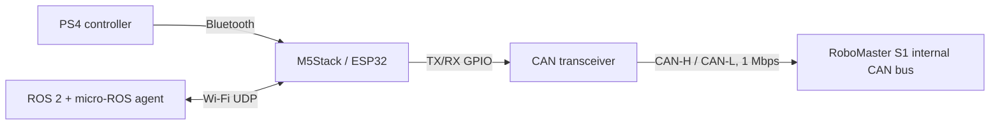
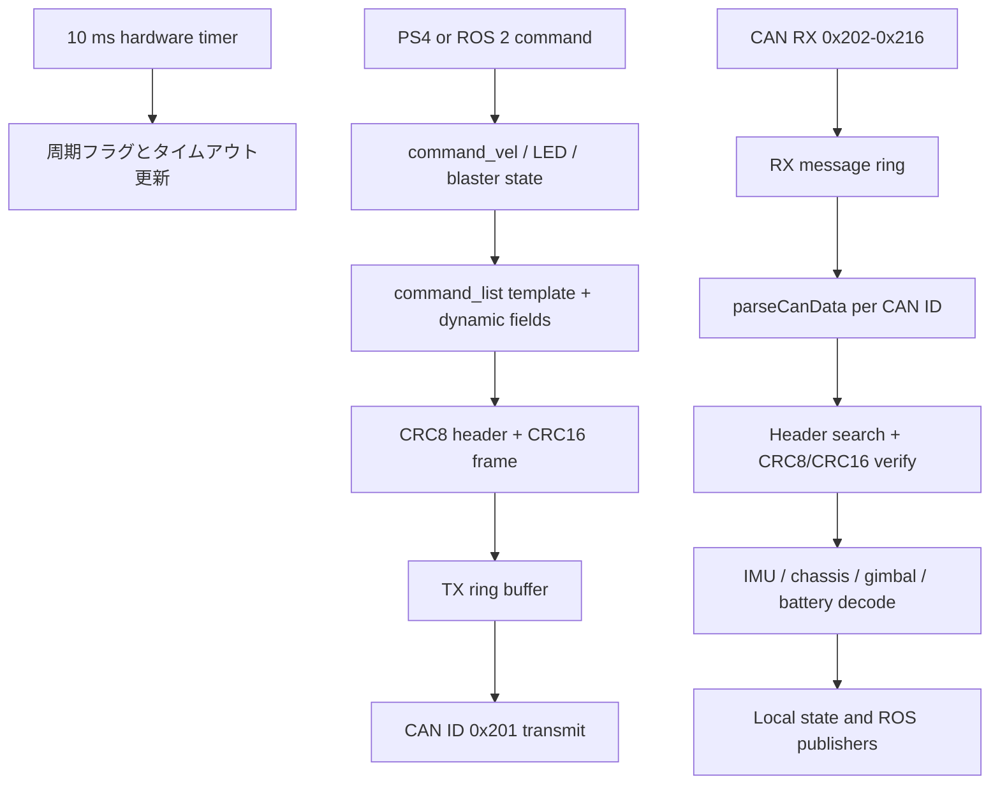
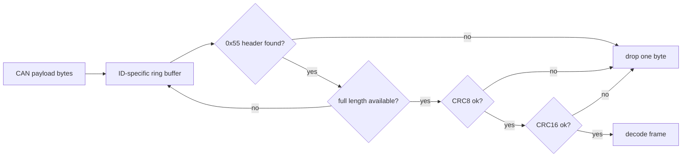
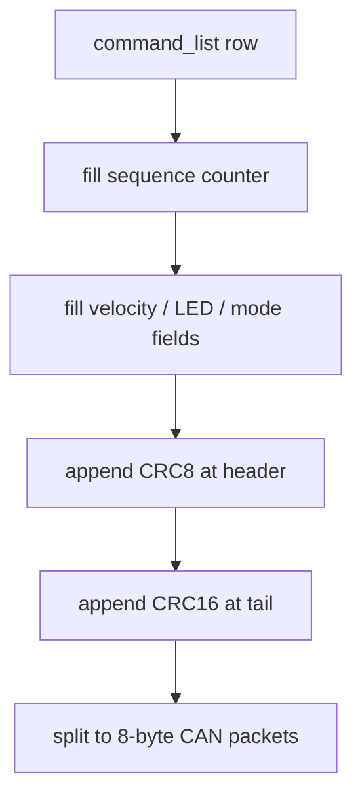
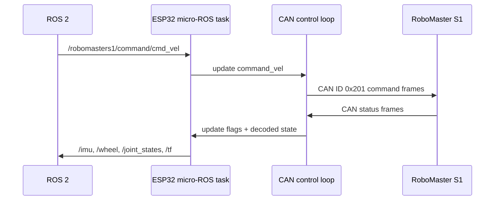

# RoboStack S1

[English README](README.md)

RoboStack S1 は、M5Stack/ESP32 から DJI RoboMaster S1 の内部 CAN バスへ接続し、移動、ジンバル、LED、ブラスター、状態取得を扱うための Arduino スケッチ集です。micro-ROS 版では、RoboMaster S1 の状態を ROS 2 に publish できます。

| フォルダ | 用途 |
| --- | --- |
| `RoboStackS1` | M5Core2 と PS4 コントローラで RoboMaster S1 を直接操作する基本版 |
| `RoboStackS1_avatar` | 基本版に M5Stack Avatar 表示を加えた版 |
| `RoboStackS1_micro-ros` | micro-ROS 経由で ROS 2 から操作し、IMU、ホイール、TF、ジンバル状態を publish する版 |

## できること

- RoboMaster S1 の CAN バスへ 1 Mbps で接続する
- 起動時に Lab/Odometry 系の内部コマンドを送って、通常アプリ外から状態データを取得できるようにする
- chassis の前後左右移動、yaw、gimbal pitch/yaw を送信する
- LED 色変更、ブラスター、ゲル弾ブラスター、被弾/復帰系コマンドを送信する
- micro-ROS 版では `/robomasters1/command/*` を subscribe し、`/robomasters1/status/*` と `/tf` を publish する

## 注意

RoboMaster S1 の内部 CAN バスへ直接アクセスします。メーカーが公開している一般ユーザー向けAPIではありません。作業前に電源、配線、絶縁、電流容量、終端抵抗を確認し、自己責任で行ってください。ブラスターや走行系を扱うため、周囲の安全を確保してから動作確認してください。

## 必要なもの

- M5Stack Core2 または ESP32 系ボード
- DJI RoboMaster S1
- CAN トランシーバモジュール
- Arduino IDE、Arduino CLI、または同等の Arduino ビルド環境
- 基本版/Avatar版: `M5Core2` または `M5Unified`、`PS4Controller`、`CAN` ライブラリ
- micro-ROS版: `micro_ros_arduino`、ROS 2、micro-ROS agent

## 配線の考え方

ESP32 は CAN コントローラを内蔵していますが、CAN バスへ直接は接続できません。必ず CAN トランシーバを介して RoboMaster S1 の CAN-H/CAN-L へ接続します。GPIO は使用する `CAN` ライブラリ、ボード、トランシーバに合わせて設定してください。



スケッチは `CAN.begin(1000E3)` で 1 Mbps の CAN 通信を開始します。

## 使い方

### 基本版

1. Arduino IDE で [RoboStackS1/RoboStackS1.ino](RoboStackS1/RoboStackS1.ino) を開きます。
2. 必要な Arduino ライブラリをインストールします。
3. 必要に応じて `PS4.begin("8C:AA:B5:81:71:BA")` のコントローラアドレスを変更します。
4. M5Stack/ESP32 へ書き込みます。
5. CAN トランシーバ経由で RoboMaster S1 の CAN バスに接続します。
6. RoboMaster S1 の電源を入れ、コマンド動作を確認します。

### Avatar版

1. Arduino IDE で [RoboStackS1_avatar/RoboStackS1_avatar.ino](RoboStackS1_avatar/RoboStackS1_avatar.ino) を開きます。
2. `M5Unified`、`Avatar`、`PS4Controller`、`CAN` をインストールします。
3. 基本版と同じ PS4 コントローラ設定と CAN 配線を準備します。
4. 書き込み後、Avatar 表示タスクが core 0 で動作し、制御ループは CAN 通信を処理します。

### micro-ROS版

1. [RoboStackS1_micro-ros/RoboStackS1_micro-ros.ino](RoboStackS1_micro-ros/RoboStackS1_micro-ros.ino) を開きます。
2. Wi-Fi と micro-ROS agent の接続先を設定します。

```cpp
#define MICRO_ROS_SSID "YOUR SSID"
#define MICRO_ROS_PASSWD "XXXXXXXX"
#define MICRO_ROS_SERVER_IP "YOUR IP"
#define MICRO_ROS_SERVER_PORT 8888
```

1. ROS 2 側で micro-ROS agent を起動します。

```bash
ros2 run micro_ros_agent micro_ros_agent udp4 --port 8888
```

1. ESP32 へ書き込みます。
2. ROS 2 から以下の topic を使います。

| Topic | Type | 方向 | 内容 |
| --- | --- | --- | --- |
| `/robomasters1/command/cmd_vel` | `geometry_msgs/msg/Twist` | subscribe | chassis と gimbal の速度指令 |
| `/robomasters1/command/led` | `std_msgs/msg/ColorRGBA` | subscribe | LED 色指令 |
| `/robomasters1/command/blaster` | `std_msgs/msg/Int8` | subscribe | `1`: IR blaster、`2`: gel blaster |
| `/robomasters1/command/control_mode` | `std_msgs/msg/Int8` | subscribe | yaw 制御モードを有効化 |
| `/robomasters1/status/imu` | `sensor_msgs/msg/Imu` | publish | 姿勢、加速度、角速度 |
| `/robomasters1/status/wheel` | `std_msgs/msg/Float32MultiArray` | publish | wheel angle、RPM、update counter |
| `/robomasters1/status/chassis_info2` | `std_msgs/msg/Float32MultiArray` | publish | 電圧、温度、電流、SOC |
| `/joint_states` | `sensor_msgs/msg/JointState` | publish | gimbal joint state |
| `/tf` | `tf2_msgs/msg/TFMessage` | publish | `base_link` と `odom` の姿勢 |

例:

```bash
ros2 topic pub /robomasters1/command/cmd_vel geometry_msgs/msg/Twist \
  "{linear: {x: 0.3, y: 0.0, z: 0.0}, angular: {x: 0.0, y: 0.0, z: 0.2}}"
```

## 実装アーキテクチャ

全体は、CAN受信、RoboMaster S1 独自フレームの再構成、CRC検証、状態デコード、コマンド生成、CAN送信に分かれています。



### CAN ID とフレーム再構成

RoboMaster S1 は 8 byte の CAN ペイロードに、`0x55` で始まる可変長フレームを分割して流しています。スケッチは CAN ID ごとにリングバッファを持ち、分割されたバイト列を再構成します。

受信対象は `0x202`, `0x203`, `0x204`, `0x211` から `0x216` です。

再構成アルゴリズムは次の流れです。

1. CAN payload を CAN ID 別リングバッファへ追加する
2. `0x55` かつ protocol version `0x04` のヘッダを探す
3. 2 byte目の長さを読み、フレーム全体が揃うまで待つ
4. header CRC8 を検証する
5. frame CRC16 を検証する
6. 成功したら `received_data` にコピーし、状態を decode する
7. CRCエラー時は1 byteだけ捨てて再同期する



### コマンド生成

[Common/command_list.h](Common/command_list.h) には RoboMaster S1 へ送る既知コマンドのテンプレートが入っています。各行の2番目の値は送信周期です。

| 周期値 | 意味 |
| --- | --- |
| `1` | 10 ms周期で送信 |
| `10` | 100 ms周期で送信 |
| `100` | 1 s周期で送信 |
| `0xFF` | イベント発生時のみ送信 |

テンプレート内の `0xFF` は動的フィールドとして扱います。代表例はシーケンスカウンタ、CRC、LED RGB、速度指令です。



速度指令は RoboMaster S1 側の内部表現に合わせ、`linear.x`, `linear.y`, `angular.z` を bit field へ詰めています。ジンバルは `angular.y`, `angular.z` を signed control value として詰めています。

### micro-ROS のデータ経路

micro-ROS版では、ROS 2 topic の callback がグローバルな command state を更新し、10 ms周期タスクが CAN コマンドに変換します。状態データは CAN から decode されたタイミングで update flag を立て、core 0 側の micro-ROS タスクが publish します。



## 主要ファイル

| ファイル | 内容 |
| --- | --- |
| `RoboStackS1*/RoboStackS1*.ino` | ボード初期化、周期タスク、CAN送受信、PS4/micro-ROS連携 |
| `Common/command_list.h` | RoboMaster S1 に送る内部コマンドテンプレート |
| `Common/robomaster_s1.c` | CAN ID別リングバッファ、フレーム再構成、姿勢変換 |
| `Common/robomaster_s1_crc.c` | RoboMaster系フレームの CRC8/CRC16 |
| `RoboStackS1*/robomaster_s1*.c`, `RoboStackS1*/robomaster_s1*.h`, `RoboStackS1*/command_list.h` | Arduino IDE が各スケッチを直接開いたときに `Common` の共通ファイルを一緒にビルドするための薄いラッパ |

## トラブルシュート

| 症状 | 確認すること |
| --- | --- |
| CAN開始に失敗する | トランシーバ配線、終端抵抗、GPIO設定、電源を確認する |
| 起動後に反応しない | RoboMaster S1 の電源投入順、CAN-H/CAN-Lの極性、1 Mbps設定を確認する |
| PS4コントローラがつながらない | Bluetooth ペアリングと `PS4.begin()` のアドレスを確認する |
| micro-ROS node が見えない | Wi-Fi設定、agent IP、UDP port、ネットワーク疎通を確認する |
| 長時間で不安定になる | 電源電圧、CANノイズ、Wi-Fi品質、ESP32の温度を確認する |

## 開発メモ

RoboMasterプロトコルの共通処理は `Common` に集約しています。各スケッチフォルダには、Arduino IDE で直接開いたときに共通 `.c` ファイルも一緒にビルドされるよう、薄いラッパだけを置いています。
