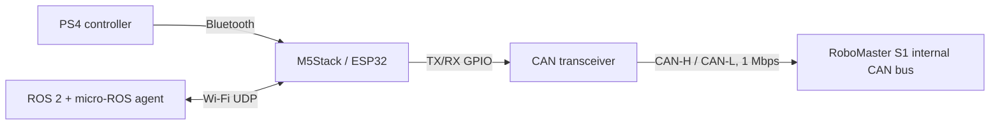
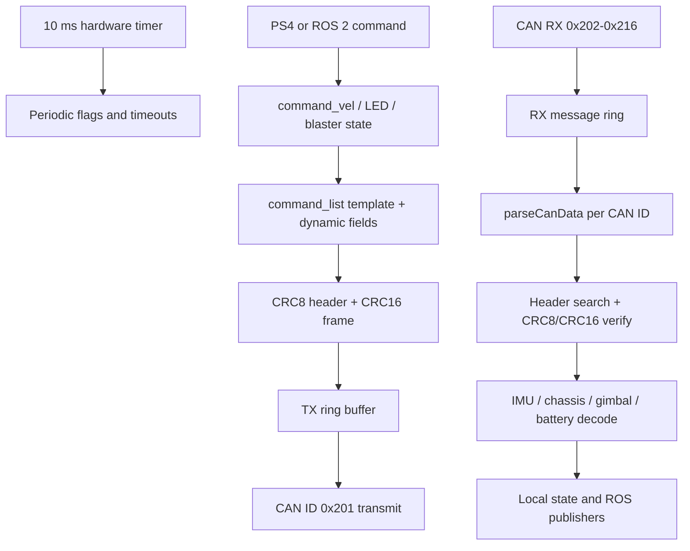
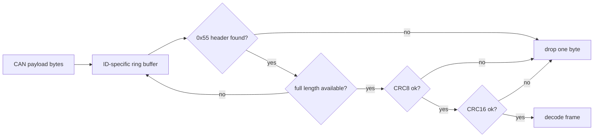
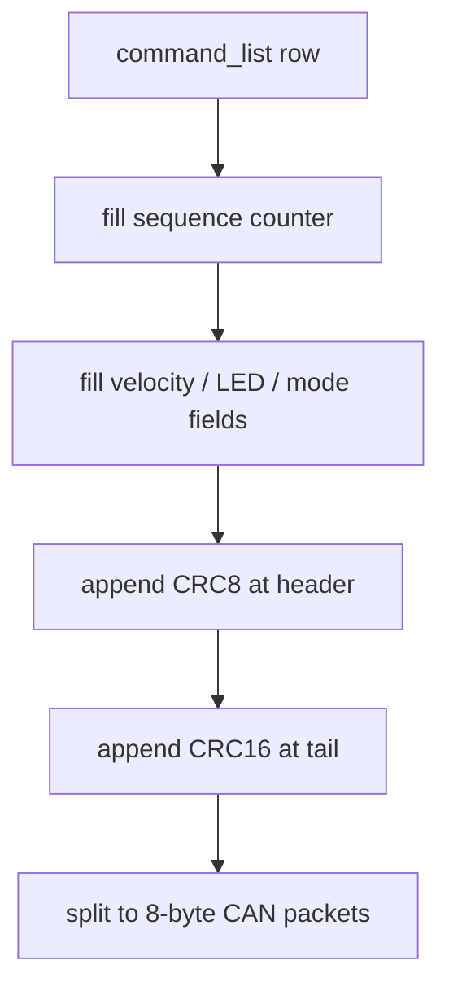
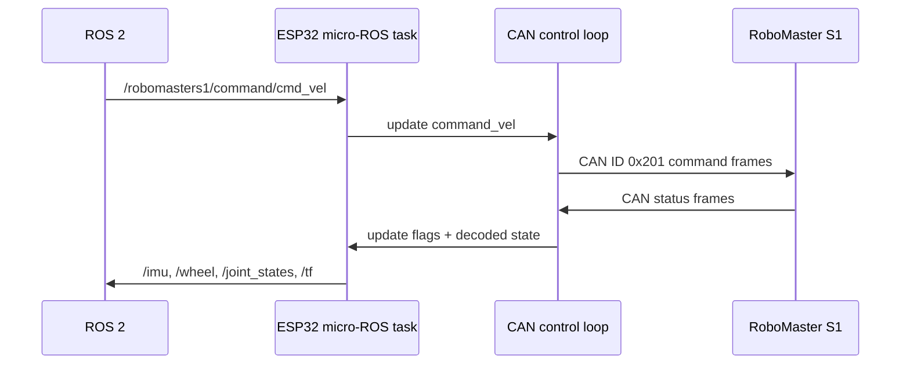

# RoboStack S1

[日本語版はこちら](README.ja.md)

RoboStack S1 is a set of Arduino sketches for controlling a DJI RoboMaster S1 from an M5Stack/ESP32 board through the S1 internal CAN bus. It sends drive, gimbal, LED, blaster, and initialization commands, and the micro-ROS sketch exposes S1 telemetry to ROS 2.

| Folder | Purpose |
| --- | --- |
| `RoboStackS1` | Basic M5Core2 + PS4 controller sketch for direct RoboMaster S1 control |
| `RoboStackS1_avatar` | Basic controller sketch with M5Stack Avatar display support |
| `RoboStackS1_micro-ros` | micro-ROS sketch for ROS 2 command input and telemetry publishing |

## Features

- Connects to the RoboMaster S1 internal CAN bus at 1 Mbps.
- Sends startup commands that enable Lab/Odometry-style telemetry outside the official app workflow.
- Sends chassis forward/back/strafe/yaw commands and gimbal pitch/yaw commands.
- Controls LEDs, the IR blaster, the gel blaster, and hit/recover commands.
- Publishes IMU, wheel, gimbal, battery, joint state, and TF data from the micro-ROS sketch.

## Safety Notice

This project communicates directly with the RoboMaster S1 internal CAN bus. That interface is not the normal public user API. Check wiring, insulation, power supply stability, current capacity, and CAN bus termination before powering the robot. The sketches can move the chassis and trigger blaster commands, so test only in a safe area.

## Requirements

- M5Stack Core2 or another compatible ESP32 board
- DJI RoboMaster S1
- CAN transceiver module
- Arduino IDE, Arduino CLI, or an equivalent Arduino build environment
- Basic/Avatar sketches: `M5Core2` or `M5Unified`, `PS4Controller`, and `CAN` libraries
- micro-ROS sketch: `micro_ros_arduino`, ROS 2, and a micro-ROS agent

## Wiring Overview

ESP32 includes a CAN controller, but it still needs an external CAN transceiver to connect to CAN-H and CAN-L. Use the GPIO mapping required by your CAN library, board, and transceiver module.



The sketches start CAN communication with `CAN.begin(1000E3)`.

## Usage

### Basic Sketch

1. Open [RoboStackS1/RoboStackS1.ino](RoboStackS1/RoboStackS1.ino) in Arduino IDE.
2. Install the required Arduino libraries.
3. Update the controller address in `PS4.begin("8C:AA:B5:81:71:BA")` if needed.
4. Flash the sketch to your M5Stack/ESP32 board.
5. Connect the board to the RoboMaster S1 CAN bus through a CAN transceiver.
6. Power on the RoboMaster S1 and start testing commands.

### Avatar Sketch

1. Open [RoboStackS1_avatar/RoboStackS1_avatar.ino](RoboStackS1_avatar/RoboStackS1_avatar.ino) in Arduino IDE.
2. Install `M5Unified`, `Avatar`, `PS4Controller`, and `CAN`.
3. Prepare the same PS4 controller and CAN wiring as the basic sketch.
4. Flash the sketch. The Avatar display task runs on core 0 while the control loop handles CAN traffic.

### micro-ROS Sketch

1. Open [RoboStackS1_micro-ros/RoboStackS1_micro-ros.ino](RoboStackS1_micro-ros/RoboStackS1_micro-ros.ino).
2. Set the Wi-Fi and micro-ROS agent parameters.

```cpp
#define MICRO_ROS_SSID "YOUR SSID"
#define MICRO_ROS_PASSWD "XXXXXXXX"
#define MICRO_ROS_SERVER_IP "YOUR IP"
#define MICRO_ROS_SERVER_PORT 8888
```

1. Start the micro-ROS agent on the ROS 2 machine.

```bash
ros2 run micro_ros_agent micro_ros_agent udp4 --port 8888
```

1. Flash the ESP32 board.
2. Use the ROS 2 topics below.

| Topic | Type | Direction | Description |
| --- | --- | --- | --- |
| `/robomasters1/command/cmd_vel` | `geometry_msgs/msg/Twist` | subscribe | Chassis and gimbal velocity command |
| `/robomasters1/command/led` | `std_msgs/msg/ColorRGBA` | subscribe | LED color command |
| `/robomasters1/command/blaster` | `std_msgs/msg/Int8` | subscribe | `1`: IR blaster, `2`: gel blaster |
| `/robomasters1/command/control_mode` | `std_msgs/msg/Int8` | subscribe | Enables yaw control mode |
| `/robomasters1/status/imu` | `sensor_msgs/msg/Imu` | publish | IMU orientation, acceleration, and angular velocity |
| `/robomasters1/status/wheel` | `std_msgs/msg/Float32MultiArray` | publish | Wheel angle, RPM, and update counters |
| `/robomasters1/status/chassis_info2` | `std_msgs/msg/Float32MultiArray` | publish | Voltage, temperature, current, and state of charge |
| `/joint_states` | `sensor_msgs/msg/JointState` | publish | Gimbal joint state |
| `/tf` | `tf2_msgs/msg/TFMessage` | publish | Orientation transform between `base_link` and `odom` |

Example command:

```bash
ros2 topic pub /robomasters1/command/cmd_vel geometry_msgs/msg/Twist \
  "{linear: {x: 0.3, y: 0.0, z: 0.0}, angular: {x: 0.0, y: 0.0, z: 0.2}}"
```

## Architecture

The sketches are organized around CAN receive, RoboMaster S1 frame reconstruction, CRC validation, telemetry decoding, command generation, and CAN transmit.



### CAN Frame Reconstruction

The RoboMaster S1 sends variable-length frames split across 8-byte CAN payloads. Each reconstructed protocol frame starts with `0x55` and uses protocol version `0x04`. The parser keeps an independent byte ring buffer for each supported CAN ID.

Supported receive IDs are `0x202`, `0x203`, `0x204`, and `0x211` through `0x216`.

The parser flow is:

1. Append incoming CAN payload bytes to the ring buffer for that CAN ID.
2. Search for a `0x55` frame header and protocol version `0x04`.
3. Read the frame length from the second byte.
4. Wait until the full frame is available.
5. Validate the header CRC8.
6. Validate the frame CRC16.
7. Copy the verified frame into `received_data` and decode it.
8. On CRC failure, drop one byte and resynchronize.



### Command Generation

[Common/command_list.h](Common/command_list.h) contains known RoboMaster S1 internal command templates. The second field in each row controls the sending interval.

| Interval value | Meaning |
| --- | --- |
| `1` | Send every 10 ms |
| `10` | Send every 100 ms |
| `100` | Send every 1 s |
| `0xFF` | Send only on an event |

Template bytes marked with `0xFF` are dynamic fields. They are filled with sequence counters, CRC bytes, LED RGB values, or velocity bit fields depending on the command.



Chassis velocity commands pack `linear.x`, `linear.y`, and optionally `angular.z` into the RoboMaster S1 internal bit layout. Gimbal commands pack `angular.y` and `angular.z` as signed control values.

### micro-ROS Data Flow

The micro-ROS sketch receives ROS 2 commands in subscription callbacks, updates shared command state, and lets the 10 ms control loop translate that state into CAN frames. Telemetry decoded from CAN frames sets update flags that the micro-ROS task publishes to ROS 2.



## Key Files

| File | Description |
| --- | --- |
| `RoboStackS1*/RoboStackS1*.ino` | Board setup, periodic tasks, CAN RX/TX, PS4 or micro-ROS integration |
| `Common/command_list.h` | RoboMaster S1 internal command templates |
| `Common/robomaster_s1.c` | CAN ID ring buffers, frame reconstruction, quaternion helpers |
| `Common/robomaster_s1_crc.c` | CRC8 and CRC16 helpers for RoboMaster-style frames |
| `RoboStackS1*/robomaster_s1*.c`, `RoboStackS1*/robomaster_s1*.h`, `RoboStackS1*/command_list.h` | Thin Arduino build wrappers that include the shared files from `Common` |

## Troubleshooting

| Symptom | Check |
| --- | --- |
| CAN does not start | CAN transceiver wiring, termination, GPIO mapping, and power supply |
| The S1 does not respond | Power order, CAN-H/CAN-L polarity, and 1 Mbps CAN speed |
| PS4 controller does not connect | Bluetooth pairing and the address passed to `PS4.begin()` |
| micro-ROS node is not visible | Wi-Fi credentials, agent IP, UDP port, and network reachability |
| Long-running tests become unstable | Power quality, CAN noise, Wi-Fi quality, and ESP32 temperature |

## Development Notes

Shared RoboMaster protocol code lives in `Common`. Each sketch folder keeps small wrapper files so Arduino IDE can compile the shared `.c` files when that sketch is opened directly.
